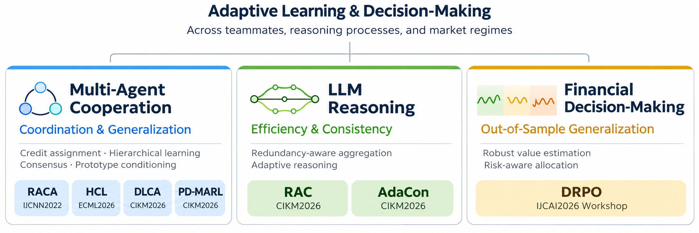

I’m currently a Ph.D. student in Computer Science advised by [Prof. Jianbin Jiao](https://people.ucas.edu.cn/~jiaojianbin), at [Pattern Recognition and Intelligent System Development Laboratory](http://lamp.ucas.ac.cn/), [School of Emergency Management Science and Engineering, University of Chinese Academy of Sciences](https://emse.ucas.edu.cn/index.php/zh). My research interests include Reinforcement Learning, Multi-agent Learning, and Large Language Model (LLM) Agents. If you are interested in my experience or research, please feel free to contact me via [Email](mailto:chenhao915@mails.ucas.ac.cn).

Research
======

Education
======
* 2023.9 - 2024.8 : Visiting Scholar at [SpaceTimeLab, University College London](https://www.ucl.ac.uk/civil-environmental-geomatic-engineering/research/groups-centres-and-sections/spacetimelab), advised by [Prof. Tao Cheng](https://www.ucl.ac.uk/civil-environmental-geomatic-engineering/people/prof-tao-cheng)
* 2022.9 - Present : Ph.D. in Computer Science, [School of Emergency Management Science and Engineering, University of Chinese Academy of Sciences](https://emse.ucas.edu.cn/index.php/zh), advised by [Prof. Jianbin Jiao](https://people.ucas.edu.cn/~jiaojianbin)
* 2019.9 - 2022.6 : M.S. in Pattern Recognition and Intelligent System, [Institute of Automation, Chinese Academy of Sciences](http://www.ia.cas.cn/), advised by [Prof. Kaiqi Huang](http://people.ucas.ac.cn/~huangkaiqi?language=en)
* 2015.9 - 2019.6 : B.E. in Computer Science, [University of Chinese Academy of Sciences](https://www.ucas.ac.cn/), advised by [Prof. Yidong Gu](https://casad.cas.cn/ysxx2022/ysmd/jskx/200906/t20090624_1808361.html)
* 2012.9 - 2015.6 : [Northeast Yucai School](https://www.neyc.cn/Category_1451/Index.aspx)

Publications
======

## Conferences
* **Dual-Level Consensus Alignment for Multi-Agent Cooperation** 
  **Hao Chen**, Meiqi Wu, Yang Yu, Kaiqi Huang, Jianbin Jiao 
  *[CIKM2026](https://cikm2026.diag.uniroma1.it/)* · [[Paper](https://doi.org/10.1145/3799682.3840024)] [[bibTeX](/files/DLCA.bib)]
* **Prototype-Driven Multi-Agent Reinforcement Learning for Active Voltage Control via Contrastive Latent Conditioning** 
  **Hao Chen**, Meiqi Wu, Yang Yu, Kaiqi Huang, Jianbin Jiao 
  *[CIKM2026](https://cikm2026.diag.uniroma1.it/)* · [[Paper](https://doi.org/10.1145/3799682.3840025)] [[bibTeX](/files/PD-MARL.bib)]
* **Redundancy-Aware Self-Consistency for Efficient LLM Reasoning** 
  **Hao Chen**, Xinke Jiang, Kaiqi Huang, Jianbin Jiao 
  *[CIKM2026](https://cikm2026.diag.uniroma1.it/)* · [[Paper](https://doi.org/10.1145/3799682.3840000)] [[bibTeX](/files/RAC.bib)]
* **AdaCon: Learning Adaptive Trust Regions for Consistent LLM Agent Reasoning** 
  **Hao Chen**, Xinke Jiang, Kaiqi Huang, Jianbin Jiao 
  *[CIKM2026](https://cikm2026.diag.uniroma1.it/)* · [[Paper](https://doi.org/10.1145/3799682.3840027)] [[bibTeX](/files/AdaCon.bib)]
* **Hierarchical Cognitive Learning for Cooperative Multi-agent Reinforcement Learning** 
  **Hao Chen**, Meiqi Wu, Yang Yu, Kaiqi Huang, Jianbin Jiao 
  *[ECML PKDD2026](https://ecmlpkdd.org/2026/) (Oral)* · [[Paper](https://doi.org/10.1007/978-3-032-37670-1_19)] [[bibTeX](/files/HCL.bib)]
* **TC-RAG: Turing-Complete RAG's Case study on Medical LLM Systems** 
  Xinke Jiang, Yue Fang, Rihong Qiu, Haoyu Zhang, Yongxin Xu, **Hao Chen**, Wentao Zhang, Ruizhe Zhang, Yuchen Fang, Xinyu Ma, Xu Chu, Junfeng Zhao, Yasha Wang 
  *[ACL2025](https://2025.aclweb.org/)* · [[Paper](https://aclanthology.org/2025.acl-long.558/)] [[arXiv](https://arxiv.org/abs/2408.09199)] [[Code](https://github.com/Artessay/TC-RAG)] [[bibTeX](/files/RAG.bib)]
* **Time Series Supplier Allocation via Deep Black-Litterman Model** 
  Xinke Jiang, Wentao Zhang, Yuchen Fang, Xiaowei Gao, **Hao Chen**, Haoyu Zhang, Dingyi Zhuang, Jiayuan Luo  
  *[AAAI2025](https://aaai.org/Conferences/AAAI-25/) (Oral)* · [[Paper](https://ojs.aaai.org/index.php/AAAI/article/view/33292)] [[arXiv](https://arxiv.org/abs/2401.17350)] [[Code](https://github.com/QiuFengqing/DBLM)] [[Slides](/files/DBLM_PPT.pdf)] [[Poster](/files/DBLM_poster.pdf)] [[bibTeX](/files/DBLM.bib)]
* **PDiT: Interleaving Perception and Decision-making Transformers for Deep Reinforcement Learning** 
  Hangyu Mao, Rui Zhao, Ziyue Li, Zhiwei Xu, **Hao Chen**, Yiqun Chen, Bin Zhang, Zhen Xiao, Junge Zhang and Jiangjin Yin 
  *[AAMAS2024](https://www.aamas2024-conference.auckland.ac.nz/) (Oral)* · [[Paper](https://dl.acm.org/doi/abs/10.5555/3635637.3662995)] [[arXiv](https://arxiv.org/abs/2312.15863)] [[Code](https://github.com/maohangyu/PDiT)] [[bibTeX](/files/PDiT.bib)]
  <!-- 毛航宇，赵瑞，黎子玥，徐志伟，陈皓，陈逸群，张斌，肖臻，张俊格，尹江津 -->
* **Uncertainty Quantification via Spatial-Temporal Tweedie Model for Zero-inflated and Long-tail Travel Demand Prediction** 
  Xinke Jiang, Dingyi Zhuang, Xianghui Zhang, **Hao Chen**, Jiayuan Luo, Xiaowei Gao 
  *[CIKM2023](https://uobevents.eventsair.com/cikm2023/) (Poster)* · [[Paper](https://dl.acm.org/doi/10.1145/3583780.3615215)] [[arXiv](https://arxiv.org/abs/2306.09882)] [[Code](https://github.com/STTDAnonymous/STTD)] [[Poster](/files/CIKM2023.pdf)] [[bibTeX](/files/STTD.bib)]
* **Consensus Learning for Cooperative Multi-Agent Reinforcement Learning** 
  Zhiwei Xu, Bin Zhang, Dapeng Li, Zeren Zhang, Guangchong Zhou, **Hao Chen**, Guoliang Fan 
  *[AAAI2023](https://aaai.org/Conferences/AAAI-23/) (Oral)* · [[Paper](https://ojs.aaai.org/index.php/AAAI/article/view/26385)] [[arXiv](https://arxiv.org/abs/2206.02583)] [[Code](https://github.com/deligentfool/COLA)] [[bibTeX](/files/AAAI2023-1.bib)]
* **Explicitly Learning Policy Under Partial Observability in Multiagent Reinforcement Learning** 
  Chen Yang, Guangkai Yang, **Hao Chen**, Junge Zhang 
  *[IJCNN2023](https://2023.ijcnn.org/) (Oral)* · [[Paper](https://ieeexplore.ieee.org/abstract/document/10191476)] [[Slides](/files/ELP.pdf)] [[bibTeX](/files/IJCNN2023-1.bib)]
* **Underexplored Subspace Mining for Sparse-Reward Cooperative Multi-Agent Reinforcement Learning** 
  Yang Yu, Qiyue Yin, Junge Zhang, **Hao Chen**, Kaiqi Huang 
  *[IJCNN2023](https://2023.ijcnn.org/) (Oral)* · [[Paper](https://ieeexplore.ieee.org/abstract/document/10191833)] [[Slides](/files/USM.pdf)] [[bibTeX](/files/IJCNN2023-2.bib)]
* **RACA: Relation-Aware Credit Assignment for Ad-Hoc Cooperation in Multi-Agent Deep Reinforcement Learning** 
  **Hao Chen**, Guangkai Yang, Junge Zhang, Qiyue Yin, Kaiqi Huang 
  *[IJCNN2022](https://wcci2022.org/) (Oral)* · [[Paper](https://ieeexplore.ieee.org/document/9892225/)] [[arXiv](https://arxiv.org/abs/2206.01207)] [[Slides](/files/RACA.pdf)] [[bibTeX](/files/IJCNN2022-1.bib)]
* **Multi-Agent Uncertainty Sharing for Cooperative Multi-Agent Reinforcement Learning** 
  Guangkai Yang, **Hao Chen**, Junge Zhang, Qiyue Yin, Kaiqi Huang 
  *[IJCNN2022](https://wcci2022.org/) (Oral)* · [[Paper](https://ieeexplore.ieee.org/abstract/document/9891948/)] [[Slides](/files/MAUS.pdf)] [[bibTeX](/files/IJCNN2022-2.bib)]
* **FGA-NAS: Fast Resource-Constrained Architecture Search by Greedy-ADMM Algorithm** 
  Yifei Chen, Junge Zhang, Qiaozhe Li, **Hao Chen**, Kaiqi Huang 
  *[IJCNN2022](https://wcci2022.org/) (Oral)* · [[Paper](https://ieeexplore.ieee.org/abstract/document/9892407/)] [[Slides](/files/FGA.pdf)] [[bibTeX](/files/IJCNN2022-3.bib)]
* **Layer-Wisely Supervised Learning for One-Shot Neural Architecture Search** 
  Yifei Chen, Zhourui Guo, Qiyue Yin, **Hao Chen**, Kaiqi Huang 
  *[IJCNN2022](https://wcci2022.org/) (Poster)* · [[Paper](https://ieeexplore.ieee.org/abstract/document/9892632/)] [[bibTeX](/files/IJCNN2022-4.bib)]
* **Playing GuanDan with Large Language Models based on Prompt Engineering** 
  Tianchang Zhao, Yabin Wang, Jianbin Jiao, **Hao Chen** 
  *[ICAITA2025](https://www.ic-aita.org/)* [[bibTeX](/files/GuanDan.bib)]

## Journals
* **Multi-Channel Spatio-Temporal Data Fusion of ‘Big’ and ‘Small’ Network Data Using Transformer Networks** 
  Tao Cheng\*, **Hao Chen\***, Xianghui Zhang, Xiaowei Gao, Lu Yin, Jianbin Jiao 
  *[ISPRS International Journal of Geo-Information](https://www.mdpi.com/journal/ijgi)* · [[Paper](https://www.mdpi.com/2220-9964/14/8/286)] [[Issue Cover](https://www.mdpi.com/2220-9964/14/8)] [[bibTeX](/files/MCST-DF.bib)]
* **Exploration via Embracing Diversity in Reinforcement Learning for Sparse-Reward Procedurally-Generated Tasks** 
  Pei Xu, **Hao Chen**, Wenjie Yang, Kaiqi Huang 
  *[IEEE Transactions on Systems, Man and Cybernetics: Systems](https://ieeexplore.ieee.org/xpl/RecentIssue.jsp?punumber=6221021)* · [[Paper](https://ieeexplore.ieee.org/abstract/document/11033165)] [[bibTeX](/files/EED.bib)]
* **Local Observation Reconstruction for Ad-Hoc Cooperation** 
  (面向Ad-Hoc协作的局部观测重建方法) 
  **Hao Chen**, Likun Yang, Qiyue Yin, Kaiqi Huang 
  *[Journal of University of Chinese Academy of Sciences](http://journal.ucas.ac.cn/EN/2095-6134/home.shtml)* · [[Paper](http://journal.ucas.ac.cn/CN/10.7523/j.ucas.2022.028)] [[bibTeX](/files/GKD-1.bib)]
* **Uncertainty-based Credit Assignment for Cooperative Multi-Agent Reinforcement Learning** 
  (基于不确定度的多智能体信用分配方法) 
  Guangkai Yang, **Hao Chen**, Mingyi Zhang, Qiyue Yin, Kaiqi Huang 
  *[Journal of University of Chinese Academy of Sciences](http://journal.ucas.ac.cn/EN/2095-6134/home.shtml)* · [[Paper](http://journal.ucas.ac.cn/CN/10.7523/j.ucas.2022.047)] [[bibTeX](/files/GKD-2.bib)]

## Workshop Papers
* **Distributional RL for Generalizable Portfolio Optimization** 
  **Hao Chen**, Xing Chen, Jianbin Jiao 
  *[IJCAI2026](https://2026.ijcai.org/) (Workshop)* · [[GLOW Workshop](https://glow-ijcai-2026.github.io/glow-ijcai-2026/)]
* **RACA: Relation-Aware Credit Assignment for Ad-Hoc Cooperation in Multi-Agent Deep Reinforcement Learning** 
  **Hao Chen**, Guangkai Yang, Junge Zhang, Qiyue Yin, Kaiqi Huang 
  *[IJCAI2022](https://ijcai-22.org) (Workshop)* · [[Paper](https://ieeexplore.ieee.org/document/9892225/)] [[arXiv](https://arxiv.org/abs/2206.01207)] [[Slides](/files/RACA.pdf)] [[bibTeX](/files/IJCNN2022-1.bib)] · [[Workshop on Ad Hoc Teamwork](https://sites.google.com/view/ad-hoc-teamwork)]

## Pre-prints
* **Multi-Channel Spatio-Temporal Data Fusion of Network-Wide "Big" and "Small" Flow Data** 
  Tao Cheng\*, **Hao Chen\***, Xianghui Zhang, Xiaowei Gao, Lu Yin, Jianbin Jiao 
  [[Paper(SSRN)](https://papers.ssrn.com/sol3/papers.cfm?abstract_id=5027625)] [[bibTeX](/files/MCST-DF-SSRN.bib)]
* **Transformer in Transformer as Backbone for Deep Reinforcement Learning** 
  Hangyu Mao, Rui Zhao, **Hao Chen**, Jianye Hao, Yiqun Chen, Dong Li, Junge Zhang, Zhen Xiao 
  [[arXiv](https://arxiv.org/abs/2212.14538)] [[Code](https://github.com/maohangyu/TIT_open_source)] [[bibTeX](/files/TIT.bib)]

## Patents
* **Privacy-preserved Fully Decentralized Multi-agent Reinforcement Learning for Networked Social Systems** 
  (多智能体通信方法、装置、存储介质和电子设备) · CN: CN117579358A · Junge Zhang, Dan Qiao, **Hao Chen**
<!-- 张俊格, 乔丹, **陈皓** -->
* **Learning Stochastic Credit Assignment for Cooperative Multi-Agent Reinforcement Learning** 
  (多智能体信用分配方法、装置、可读存储介质和智能体) · CN: CN115660110B · Junge Zhang, Mingyi Zhang, Guangkai Yang, **Hao Chen**, Kaiqi Huang, Dandan Chen, Lu Wang
<!-- 张俊格, 张茗奕, 杨光开, **陈皓**, 黄凯奇, 陈丹丹, 王陆 -->
* **Learning Ensemble Credit Assignment for Multi-Agent Reinforcement Learning** 
  (基于集成学习的多智能体信用分配方法、系统、设备) · CN: CN115018017A · Junge Zhang, Kaiqi Huang, **Hao Chen**, Guangkai Yang
<!-- 张俊格, 黄凯奇, **陈皓**, 杨光开 -->

<!-- Paper, arXiv, Blog, Code, Slides, Video, bibTeX, Data, Website, Project page, Poster, Reviews, Link, Appendix, Reviews -->

Experiences
======
* 2022.7 - Present : Joint PhD Training Program at [Institute of Automation, Chinese Academy of Sciences](http://www.ia.cas.cn/)
* 2019.2 - 2019.7 : Research internship at [Institute of Automation, Chinese Academy of Sciences](http://www.ia.cas.cn/), advised by [Prof. Junge Zhang](http://people.ucas.edu.cn/~ZHANGJUNGE) and [Prof. Qiyue Yin](http://people.ucas.edu.cn/~yqy)
* 2019.1 : Winter camp at [Xi'an Institute of Optics and Precision Mechanics, Chinese Academy of Sciences](http://english.opt.cas.cn/)
* 2018.3 - 2018.7 : Research internship at [Institute of Software, Chinese Academy of Sciences](http://www.is.cas.cn/), advised by [Prof. Wensheng Dou](http://people.ucas.edu.cn/~wsdou)
* 2016.7 - 2016.9 : Research internship at [Technology and Engineering Center for Space Utilization, Chinese Academy of Sciences](http://www.csu.cas.cn/), advised by [Prof. Yidong Gu](https://casad.cas.cn/ysxx2022/ysmd/jskx/200906/t20090624_1808361.html)
* 2014.7 : Summer camp at [University of Chinese Academy of Sciences](https://www.ucas.ac.cn/)

Awards & Honors
======
* 2026 [Gold Tier Reviewer](https://2026.ijcai.org/ppi-reviewer-benefits-tier-definitions/), IJCAI-ECAI 2026 Primary Paper Initiative (PPI)
* 2024 Outstanding Merit Student of University of Chinese Academy of Sciences (中国科学院大学三好学生标兵)
* 2023 Zhu Li Yuehua Excellent Doctoral Student Award of Chinese Academy of Sciences (中国科学院朱李月华优秀博士生奖学金)
* 2023 CSC Scholarship (国家留学基金委奖学金)
* 2022, 2023, 2024 Merit Student of University of Chinese Academy of Sciences (中国科学院大学三好学生）
* 2019 - 2025 Academic Scholarship of University of Chinese Academy of Sciences (中国科学院大学学业奖学金）
* 2017 Merit Student of Chinese Academy of Sciences (中国科学院优秀共青团员）
* 2017, 2018 Merit Student of University of Chinese Academy of Sciences (中国科学院大学优秀共青团员）
* 2017 Third Prize of the National Scholarship
* 2018 Second Prize in China Undergraduate Mathematical Contest in Modeling
<!-- * , Beijing Division -->
* 2017, 2018 Outstanding Individual of Students' Association Union
* 2018 Third Prize of the "UCAS Cup" Innovation and Entrepreneurship Competition
* 2018 Outstanding Volunteer of IEEE UCAS Branch
* 2017 Outstanding Member of UCAS National Flag Guard
* 2017 Third Prize in the 4th Undergraduate National Flag Raiser Competition

Professional Services
======

## Chair
* Session chair for [AAG 2024](https://www.aag.org/events/aag2024/)

## Invited Talks
* 2024.4.16 Invited talk "Calibrating Driving Flow Data through the Integration of Big and Small Data: The Graph Transformer Network Approach" at session [SpaceTimeAI for Multi-Model Data Fusion](https://aag.secure-platform.com/aag2024/solicitations/57/sessiongallery/7798) of [the 2024 annual meeting of the American Association of Geographers](https://www.aag.org/events/aag2024/) 
* 2024.3.19 Invited talk "Spatio-Temporal Data Fusion" at [Spatial-Temporal Data Analysis and Data Mining (CEGE0042)](https://www.ucl.ac.uk/module-catalogue/modules/CEGE0042), a core course for MSc Geospatial Science and MSc Spatio-temporal Analytics and Big Data Mining, led by [Dr James Haworth](https://profiles.ucl.ac.uk/24884) 
* 2023.9.29 Invited talk "Multi-Agent Deep Reinforcement Learning: Background and Recent Works" at [SpaceTimeLab, University College London](https://www.ucl.ac.uk/civil-environmental-geomatic-engineering/research/groups-centres-and-sections/spacetimelab) 
* 2023.9.8 Invited talk "Research Experience Sharing" at [School of Emergency Management Science and Engineering, University of Chinese Academy of Sciences](https://emse.ucas.edu.cn/index.php/zh) 
* 2022.8.25 Invited talk "Deep Reinforcement Learning: Background and Recent Works" at [Institute of Mechanics, Chinese Academy of Sciences](http://www.imech.ac.cn/) 
* 2022.7.24 Invited talk "Relation-Aware Credit Assignment for Ad-Hoc Cooperation in Multi-Agent Deep Reinforcement Learning" at [2022 IJCAI workshop on Ad Hoc Teamwork](https://sites.google.com/view/ad-hoc-teamwork) 
  [[Slides](/files/RACA.pdf)]

## Program Committee Member / Conference Reviewer

[ICLR](https://iclr.cc/) 2026 · [NeurIPS](https://neurips.cc/) 2026 · [AAAI](https://aaai.org/conference/aaai/) 2025, 2026, 2027 · [AAMAS](https://www.ifaamas.org/previousaamas.html) 2025, 2026 · [IJCAI](https://www.ijcai.org/) 2023, 2024, 2025 · [IJCAI-ECAI](https://2026.ijcai.org/) 2026 · [ECML-PKDD](https://ecmlpkdd.org/2026/) 2026 · [ICASSP](https://2026.ieeeicassp.org/) 2026 · [ICME](https://signalprocessingsociety.org/event-names/icme) 2025, 2026 · [IJCNN](https://ijcnn.org/2027) 2027 · [ECAI](https://ecai2023.eu/) 2023 · [MRS](https://sites.bu.edu/mrs2023/) 2023 · [ICML](https://icml.cc/Conferences/2022) 2022 · [CAC](https://www.caa.org.cn/Uploads/image/file/20230310/20230310144525_12820.pdf) 2022, 2023 · [DAI](https://www.adai.ai/) 2025, 2026

## Journal Reviewer

[TNNLS](https://ieeexplore.ieee.org/xpl/RecentIssue.jsp?punumber=5962385 "IEEE Transactions on Neural Networks and Learning Systems") · [ToG](https://ieeexplore.ieee.org/xpl/RecentIssue.jsp?punumber=7782673 "IEEE Transactions on Games") · [IoT](https://ieee-iotj.org/ "IEEE Internet of Things Journal") · [TAGI](https://www.tandfonline.com/journals/tagi20/about-this-journal#aims-and-scope "Annals of GIS") · [IS](https://www.sciencedirect.com/journal/information-sciences "Information Sciences") · [CAAI TIT](https://ietresearch.onlinelibrary.wiley.com/journal/24682322 "CAAI Transactions on Intelligence Technology") 2026 · [TSMC: Systems](https://www.ieeesmc.org/publications/transactions-on-systems-man-and-cybernetics-systems/ "IEEE Transactions on Systems, Man, and Cybernetics: Systems")

## Other Activities
* 2024.10 - Present : Member, [AI Safety Community Researchers](https://futureoflife.org/person/chen-hao/), [Future of Life Institute](https://futureoflife.org)
* 2022.7 [The IEEE CIS Student and Early Career mentoring program](https://wcci2022.org/ieee-cis-student-and-early-career-mentoring-program/)

Media Coverage
======
* 2018 [Report by UCAS School Magazine](/files/201803.pdf)
* 2017 [Cover Person of UCAS School Magazine](/files/201704.pdf)
* 2017 [Talk on the Preparation of the College Entrance Examination](https://mp.weixin.qq.com/s/GIXhrFr_2vY9qSNG1PXOFg)

Maintained Projects
======
* [Multi-Agent Reinforcement Learning Papers](https://github.com/TimeBreaker/Multi-Agent-Reinforcement-Learning-papers)  
* [Multi-Agent Reinforcement Learning Papers with Code](https://github.com/TimeBreaker/MARL-papers-with-code)  
* [Multi-Agent Reinforcement Learning Resources Collection](https://github.com/TimeBreaker/MARL-resources-collection)  
* [Adversarial Reinforcement Learning Papers](https://github.com/TimeBreaker/Adversarial-Reinforcement-Learning-Papers)  

<!-- * [Multi-Agent Reinforcement Learning Papers](https://github.com/TimeBreaker/Multi-Agent-Reinforcement-Learning-papers)    
* [Multi-Agent Reinforcement Learning Papers with Code](https://github.com/TimeBreaker/MARL-papers-with-code)    
* [Multi-Agent Reinforcement Learning Resources Collection](https://github.com/TimeBreaker/MARL-resources-collection)    
* [Adversarial Reinforcement Learning Papers](https://github.com/TimeBreaker/Adversarial-Reinforcement-Learning-Papers)     -->

Student Activities
======
* 2017.9 - 2018.7 : President of the Students' Association Union
* 2017.9 - 2018.7 : Vice President of the Student Union
* 2016.9 - 2018.7 : Vice Captain of UCAS National Flag Guard
* 2017 [Book1](https://book.yunzhan365.com/stpe/ajje/mobile/index.html#p=1) about student activities
* 2018 [Book2](/files/book2.pdf) about student activities

For More Info
======
* [Pattern Recognition and Intelligent System Development Laboratory](http://lamp.ucas.ac.cn/)
<!-- * [Intelligence of Human-Computer Competition](http://turingai.ia.ac.cn/) -->
<!-- * [Research Group of Intelligent Gaming](http://www.ig.ia.ac.cn:81/) -->
* [Center for Research on Intelligent System and Engineering](http://www.crise.ia.ac.cn/)
<!-- * [Institute of Automation, Chinese Academy of Sciences](http://www.ia.cas.cn/) -->
<!-- * [University of Chinese Academy of Sciences](https://www.ucas.ac.cn/) -->
* [SpaceTimeLab, University College London](https://www.ucl.ac.uk/civil-environmental-geomatic-engineering/research/groups-centres-and-sections/spacetimelab)
