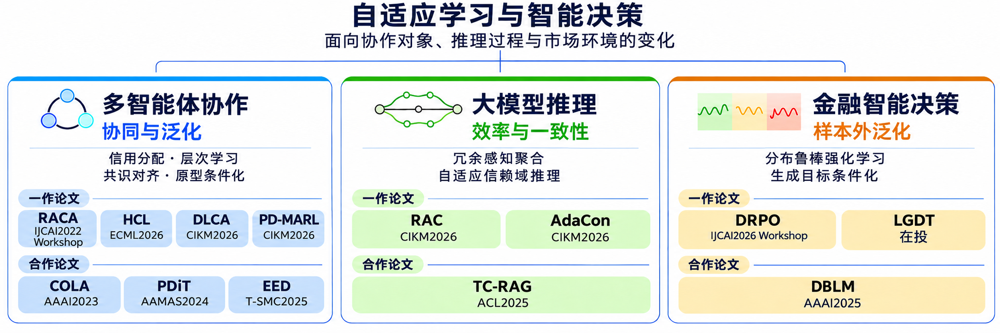

我目前是[中国科学院大学](https://www.ucas.ac.cn/)在读博士生，研究方向为多智能体强化学习与大语言模型。欢迎通过[电子邮件](mailto:chenhao915@mails.ucas.ac.cn)与我联系。

**多智能体协作：** [RACA](#paper-raca) · [HCL](#paper-hcl) · [DLCA](#paper-dlca) · [PD-MARL](#paper-pd-marl) · [COLA](#paper-cola) · [PDiT](#paper-pdit) · [EED](#paper-eed) 
**大模型推理：** [RAC](#paper-rac) · [AdaCon](#paper-adacon) · [TC-RAG](#paper-tc-rag) 
**金融智能决策：** [DRPO](#paper-drpo) · [DBLM](#paper-dblm)

教育经历 {#education}
======
* 2022.9 - 至今 : 博士研究生, [中国科学院大学](https://www.ucas.ac.cn/) · 导师： [Prof. Jianbin Jiao](https://people.ucas.edu.cn/~jiaojianbin)
* 2023.9 - 2024.8 : 访问博士研究生, [伦敦大学学院 SpaceTimeLab](https://www.ucl.ac.uk/civil-environmental-geomatic-engineering/research/groups-centres-and-sections/spacetimelab) · 导师： [Prof. Tao Cheng](https://www.ucl.ac.uk/civil-environmental-geomatic-engineering/people/prof-tao-cheng)
* 2019.9 - 2022.6 : 硕士, [中国科学院自动化研究所](http://www.ia.cas.cn/) · 导师： [Prof. Kaiqi Huang](http://people.ucas.ac.cn/~huangkaiqi?language=en)
* 2015.9 - 2019.6 : 学士, [中国科学院大学](https://www.ucas.ac.cn/) · 导师： [Prof. Yidong Gu](https://casad.cas.cn/ysxx2022/ysmd/jskx/200906/t20090624_1808361.html)

研究成果 {#publications}
======

## 会议论文
* [CIKM2026](https://cikm2026.diag.uniroma1.it/) (海报) **Dual-Level Consensus Alignment for Multi-Agent Cooperation** 
  **Hao Chen**, Meiqi Wu, Yang Yu, Kaiqi Huang, Jianbin Jiao · [[论文](https://doi.org/10.1145/3799682.3840024)] [[bibTeX](/files/DLCA.bib)]
* [CIKM2026](https://cikm2026.diag.uniroma1.it/) (海报) **Prototype-Driven Multi-Agent Reinforcement Learning for Active Voltage Control via Contrastive Latent Conditioning** 
  **Hao Chen**, Meiqi Wu, Yang Yu, Kaiqi Huang, Jianbin Jiao · [[论文](https://doi.org/10.1145/3799682.3840025)] [[bibTeX](/files/PD-MARL.bib)]
* [CIKM2026](https://cikm2026.diag.uniroma1.it/) (海报) **Redundancy-Aware Self-Consistency for Efficient LLM Reasoning** 
  **Hao Chen**, Xinke Jiang, Kaiqi Huang, Jianbin Jiao · [[论文](https://doi.org/10.1145/3799682.3840000)] [[bibTeX](/files/RAC.bib)]
* [CIKM2026](https://cikm2026.diag.uniroma1.it/) (海报) **AdaCon: Learning Adaptive Trust Regions for Consistent LLM Agent Reasoning** 
  **Hao Chen**, Xinke Jiang, Kaiqi Huang, Jianbin Jiao · [[论文](https://doi.org/10.1145/3799682.3840027)] [[bibTeX](/files/AdaCon.bib)]
* [ECML PKDD2026](https://ecmlpkdd.org/2026/) (口头报告) **Hierarchical Cognitive Learning for Cooperative Multi-agent Reinforcement Learning** 
  **Hao Chen**, Meiqi Wu, Yang Yu, Kaiqi Huang, Jianbin Jiao · [[论文](https://doi.org/10.1007/978-3-032-37670-1_19)] [[bibTeX](/files/HCL.bib)]
* [ACL2025](https://2025.aclweb.org/) (口头报告) **TC-RAG: Turing-Complete RAG's Case study on Medical LLM Systems** 
  Xinke Jiang, Yue Fang, Rihong Qiu, Haoyu Zhang, Yongxin Xu, **Hao Chen**, Wentao Zhang, Ruizhe Zhang, Yuchen Fang, Xinyu Ma, Xu Chu, Junfeng Zhao, Yasha Wang · [[论文](https://aclanthology.org/2025.acl-long.558/)] [[arXiv](https://arxiv.org/abs/2408.09199)] [[代码](https://github.com/Artessay/TC-RAG)] [[视频](https://aclanthology.org/2025.acl-long.558.mp4)] [[bibTeX](/files/RAG.bib)]
* [AAAI2025](https://aaai.org/Conferences/AAAI-25/) (口头报告) **Time Series Supplier Allocation via Deep Black-Litterman Model** 
  Xinke Jiang, Wentao Zhang, Yuchen Fang, Xiaowei Gao, **Hao Chen**, Haoyu Zhang, Dingyi Zhuang, Jiayuan Luo · [[论文](https://ojs.aaai.org/index.php/AAAI/article/view/33292)] [[arXiv](https://arxiv.org/abs/2401.17350)] [[代码](https://github.com/QiuFengqing/DBLM)] [[幻灯片](/files/DBLM_PPT.pdf)] [[海报](/files/DBLM_poster.pdf)] [[会议展示](https://underline.io/lecture/113931-time-series-supplier-allocation-via-deep-black-litterman-model)] [[bibTeX](/files/DBLM.bib)]
* [AAMAS2024](https://www.aamas2024-conference.auckland.ac.nz/) (口头报告) **PDiT: Interleaving Perception and Decision-making Transformers for Deep Reinforcement Learning** 
  Hangyu Mao, Rui Zhao, Ziyue Li, Zhiwei Xu, **Hao Chen**, Yiqun Chen, Bin Zhang, Zhen Xiao, Junge Zhang and Jiangjin Yin · [[论文](https://dl.acm.org/doi/abs/10.5555/3635637.3662995)] [[arXiv](https://arxiv.org/abs/2312.15863)] [[代码](https://github.com/maohangyu/PDiT)] [[中文介绍](https://www.ia.cas.cn/kxyj/kydt_1/202406/t20240612_7187500.html)] [[bibTeX](/files/PDiT.bib)]
* [CIKM2023](https://uobevents.eventsair.com/cikm2023/) (海报) **Uncertainty Quantification via Spatial-Temporal Tweedie Model for Zero-inflated and Long-tail Travel Demand Prediction** 
  Xinke Jiang, Dingyi Zhuang, Xianghui Zhang, **Hao Chen**, Jiayuan Luo, Xiaowei Gao · [[论文](https://dl.acm.org/doi/10.1145/3583780.3615215)] [[arXiv](https://arxiv.org/abs/2306.09882)] [[代码](https://github.com/STTDAnonymous/STTD)] [[海报](/files/CIKM2023.pdf)] [[开放访问](https://discovery.ucl.ac.uk/id/eprint/10179706/)] [[bibTeX](/files/STTD.bib)]
* [AAAI2023](https://aaai.org/Conferences/AAAI-23/) (口头报告) **Consensus Learning for Cooperative Multi-Agent Reinforcement Learning** 
  Zhiwei Xu, Bin Zhang, Dapeng Li, Zeren Zhang, Guangchong Zhou, **Hao Chen**, Guoliang Fan · [[论文](https://ojs.aaai.org/index.php/AAAI/article/view/26385)] [[arXiv](https://arxiv.org/abs/2206.02583)] [[代码](https://github.com/deligentfool/COLA)] [[会议展示](https://underline.io/lecture/68126-consensus-learning-for-cooperative-multi-agent-reinforcement-learning)] [[bibTeX](/files/AAAI2023-1.bib)]
* [IJCNN2023](https://2023.ijcnn.org/) (口头报告) **Explicitly Learning Policy Under Partial Observability in Multiagent Reinforcement Learning** 
  Chen Yang, Guangkai Yang, **Hao Chen**, Junge Zhang · [[论文](https://ieeexplore.ieee.org/abstract/document/10191476)] [[幻灯片](/files/ELP.pdf)] [[bibTeX](/files/IJCNN2023-1.bib)]
* [IJCNN2023](https://2023.ijcnn.org/) (口头报告) **Underexplored Subspace Mining for Sparse-Reward Cooperative Multi-Agent Reinforcement Learning** 
  Yang Yu, Qiyue Yin, Junge Zhang, **Hao Chen**, Kaiqi Huang · [[论文](https://ieeexplore.ieee.org/abstract/document/10191833)] [[幻灯片](/files/USM.pdf)] [[bibTeX](/files/IJCNN2023-2.bib)]
* [IJCNN2022](https://wcci2022.org/) (口头报告) **RACA: Relation-Aware Credit Assignment for Ad-Hoc Cooperation in Multi-Agent Deep Reinforcement Learning** 
  **Hao Chen**, Guangkai Yang, Junge Zhang, Qiyue Yin, Kaiqi Huang · [[论文](https://ieeexplore.ieee.org/document/9892225/)] [[arXiv](https://arxiv.org/abs/2206.01207)] [[幻灯片](/files/RACA.pdf)] [[bibTeX](/files/IJCNN2022-1.bib)]
* [IJCNN2022](https://wcci2022.org/) (口头报告) **Multi-Agent Uncertainty Sharing for Cooperative Multi-Agent Reinforcement Learning** 
  Guangkai Yang, **Hao Chen**, Junge Zhang, Qiyue Yin, Kaiqi Huang · [[论文](https://ieeexplore.ieee.org/abstract/document/9891948/)] [[幻灯片](/files/MAUS.pdf)] [[bibTeX](/files/IJCNN2022-2.bib)]
* [IJCNN2022](https://wcci2022.org/) (口头报告) **FGA-NAS: Fast Resource-Constrained Architecture Search by Greedy-ADMM Algorithm** 
  Yifei Chen, Junge Zhang, Qiaozhe Li, **Hao Chen**, Kaiqi Huang · [[论文](https://ieeexplore.ieee.org/abstract/document/9892407/)] [[幻灯片](/files/FGA.pdf)] [[bibTeX](/files/IJCNN2022-3.bib)]
* [IJCNN2022](https://wcci2022.org/) (海报) **Layer-Wisely Supervised Learning for One-Shot Neural Architecture Search** 
  Yifei Chen, Zhourui Guo, Qiyue Yin, **Hao Chen**, Kaiqi Huang · [[论文](https://ieeexplore.ieee.org/abstract/document/9892632/)] [[bibTeX](/files/IJCNN2022-4.bib)]
* [ICAITA2025](https://www.ic-aita.org/) **Playing GuanDan with Large Language Models based on Prompt Engineering** 
  Tianchang Zhao, Yabin Wang, Jianbin Jiao, **Hao Chen** · [[bibTeX](/files/GuanDan.bib)]

## 期刊论文
* [IJGI 2025](https://www.mdpi.com/journal/ijgi "ISPRS International Journal of Geo-Information") **Multi-Channel Spatio-Temporal Data Fusion of ‘Big’ and ‘Small’ Network Data Using Transformer Networks** 
  Tao Cheng\*, **Hao Chen\***, Xianghui Zhang, Xiaowei Gao, Lu Yin, Jianbin Jiao · **共同第一作者** · [[论文](https://www.mdpi.com/2220-9964/14/8/286)] [[**封面论文**](https://www.mdpi.com/2220-9964/14/8)] [[开放访问](https://discovery.ucl.ac.uk/id/eprint/10215393/)] [[bibTeX](/files/MCST-DF.bib)]
* [T-SMC 2025](https://ieeexplore.ieee.org/xpl/RecentIssue.jsp?punumber=6221021 "IEEE Transactions on Systems, Man and Cybernetics: Systems") **Exploration via Embracing Diversity in Reinforcement Learning for Sparse-Reward Procedurally-Generated Tasks** 
  Pei Xu, **Hao Chen**, Wenjie Yang, Kaiqi Huang · [[论文](https://ieeexplore.ieee.org/abstract/document/11033165)] [[bibTeX](/files/EED.bib)]

## 研讨会论文
* [IJCAI2026](https://2026.ijcai.org/) (研讨会) **Distributional RL for Generalizable Portfolio Optimization** 
  **Hao Chen**, Xing Chen, Jianbin Jiao · [[GLOW Workshop](https://glow-ijcai-2026.github.io/glow-ijcai-2026/)]
* [IJCAI2022](https://ijcai-22.org) (研讨会) **RACA: Relation-Aware Credit Assignment for Ad-Hoc Cooperation in Multi-Agent Deep Reinforcement Learning** 
  **Hao Chen**, Guangkai Yang, Junge Zhang, Qiyue Yin, Kaiqi Huang · [[论文](https://ieeexplore.ieee.org/document/9892225/)] [[arXiv](https://arxiv.org/abs/2206.01207)] [[幻灯片](/files/RACA.pdf)] [[bibTeX](/files/IJCNN2022-1.bib)] · [[Workshop on Ad Hoc Teamwork](https://sites.google.com/view/ad-hoc-teamwork)]

## 预印本
* **Transformer in Transformer as Backbone for Deep Reinforcement Learning** 
  Hangyu Mao, Rui Zhao, **Hao Chen**, Jianye Hao, Yiqun Chen, Dong Li, Junge Zhang, Zhen Xiao · [[arXiv](https://arxiv.org/abs/2212.14538)] [[代码](https://github.com/maohangyu/TIT_open_source)] [[bibTeX](/files/TIT.bib)]

## 专利
* CN117579358A **Privacy-preserved Fully Decentralized Multi-agent Reinforcement Learning for Networked Social Systems** 
  (多智能体通信方法、装置、存储介质和电子设备) 
  Junge Zhang, Dan Qiao, **Hao Chen**
* CN115660110B **Learning Stochastic Credit Assignment for Cooperative Multi-Agent Reinforcement Learning** 
  (多智能体信用分配方法、装置、可读存储介质和智能体) 
  Junge Zhang, Mingyi Zhang, Guangkai Yang, **Hao Chen**, Kaiqi Huang, Dandan Chen, Lu Wang
* CN115018017A **Learning Ensemble Credit Assignment for Multi-Agent Reinforcement Learning** 
  (基于集成学习的多智能体信用分配方法、系统、设备) 
  Junge Zhang, Kaiqi Huang, **Hao Chen**, Guangkai Yang

科研经历 {#experience}
======
* 2022.7 - 至今 : 博士联合培养， [中国科学院自动化研究所](http://www.ia.cas.cn/)
* 2019.2 - 2019.7 : 科研实习， [中国科学院自动化研究所](http://www.ia.cas.cn/), 导师： [Prof. Junge Zhang](http://people.ucas.edu.cn/~ZHANGJUNGE)、[Prof. Qiyue Yin](http://people.ucas.edu.cn/~yqy)
* 2019.1 : 冬令营， [中国科学院西安光学精密机械研究所](http://english.opt.cas.cn/)
* 2018.3 - 2018.7 : 科研实习， [中国科学院软件研究所](http://www.is.cas.cn/), 导师： [Prof. Wensheng Dou](http://people.ucas.edu.cn/~wsdou)
* 2016.7 - 2016.9 : 科研实习， [中国科学院空间应用工程与技术中心](http://www.csu.cas.cn/), 导师： [Prof. Yidong Gu](https://casad.cas.cn/ysxx2022/ysmd/jskx/200906/t20090624_1808361.html)
* 2014.7 : 夏令营， [中国科学院大学](https://www.ucas.ac.cn/)

奖项与荣誉 {#awards--honors}
======
* 2026 [IJCAI-ECAI 2026 PPI 金级审稿人](https://2026.ijcai.org/ppi-reviewer-benefits-tier-definitions/)
* 2024 [中国科学院大学三好学生标兵](https://emse.ucas.ac.cn/index.php/zh/tzgge/399-2023-2025)
* 2023 [中国科学院朱李月华优秀博士生奖学金](https://yjsgl.ucas.ac.cn/index.php/zh-cn/tzgg/332-2023)
* 2023 国家留学基金委奖学金（CSC）
* 2022、2023、2024 中国科学院大学三好学生
* 2019—2025 中国科学院大学学业奖学金
* 2017 中国科学院优秀共青团员
* 2017、2018 中国科学院大学优秀共青团员
* 2017 国家奖学金三等奖
* 2018 全国大学生数学建模竞赛二等奖
* 2017、2018 学生社团联合会优秀个人
* 2018 “国科大杯”创新创业大赛三等奖
* 2018 IEEE 国科大学生分会优秀志愿者
* 2017 国科大国旗护卫队优秀队员
* 2017 第四届大学生升旗手大赛三等奖

学术服务 {#professional-services}
======

**会议审稿：** [ICLR](https://iclr.cc/) 2026 · [NeurIPS](https://neurips.cc/) 2026 · [AAAI](https://aaai.org/conference/aaai/) 2025, 2026, 2027 · [AAMAS](https://www.ifaamas.org/previousaamas.html) 2025, 2026 · [IJCAI](https://www.ijcai.org/) 2023, 2024, 2025 · [IJCAI-ECAI](https://2026.ijcai.org/) 2026 · [ECML-PKDD](https://ecmlpkdd.org/2026/) 2026 · [ICASSP](https://2026.ieeeicassp.org/) 2026 · [ICME](https://signalprocessingsociety.org/event-names/icme) 2025, 2026 · [IJCNN](https://ijcnn.org/2027) 2027 · [ECAI](https://ecai2023.eu/) 2023 · [MRS](https://sites.bu.edu/mrs2023/) 2023 · [ICML](https://icml.cc/Conferences/2022) 2022 · [CAC](https://www.caa.org.cn/Uploads/image/file/20230310/20230310144525_12820.pdf) 2022, 2023 · [DAI](https://www.adai.ai/) 2025, 2026

**期刊审稿：** [TNNLS](https://ieeexplore.ieee.org/xpl/RecentIssue.jsp?punumber=5962385 "IEEE Transactions on Neural Networks and Learning Systems") · [ToG](https://ieeexplore.ieee.org/xpl/RecentIssue.jsp?punumber=7782673 "IEEE Transactions on Games") · [IoT](https://ieee-iotj.org/ "IEEE Internet of Things Journal") · [TAGI](https://www.tandfonline.com/journals/tagi20/about-this-journal#aims-and-scope "Annals of GIS") · [IS](https://www.sciencedirect.com/journal/information-sciences "Information Sciences") · [CAAI TIT](https://ietresearch.onlinelibrary.wiley.com/journal/24682322 "CAAI Transactions on Intelligence Technology") · [TSMC: Systems](https://www.ieeesmc.org/publications/transactions-on-systems-man-and-cybernetics-systems/ "IEEE Transactions on Systems, Man, and Cybernetics: Systems")

开源项目 {#maintained-projects}
======
* [多智能体强化学习论文](https://github.com/TimeBreaker/Multi-Agent-Reinforcement-Learning-papers)    
* [多智能体强化学习论文与代码](https://github.com/TimeBreaker/MARL-papers-with-code)    
* [多智能体强化学习资源合集](https://github.com/TimeBreaker/MARL-resources-collection)    
* [对抗强化学习论文](https://github.com/TimeBreaker/Adversarial-Reinforcement-Learning-Papers)    
